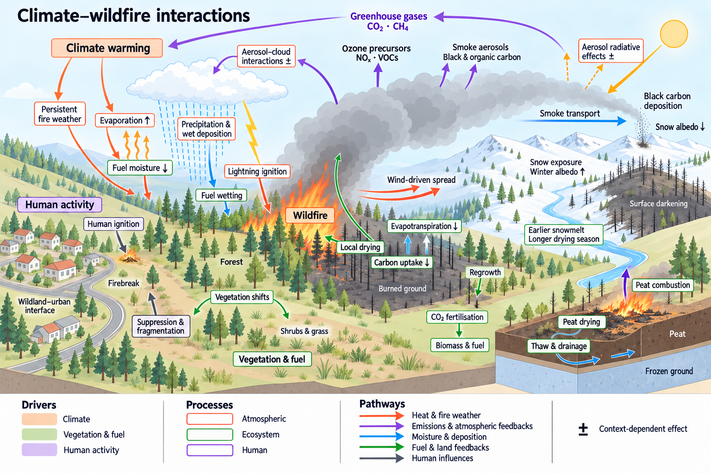
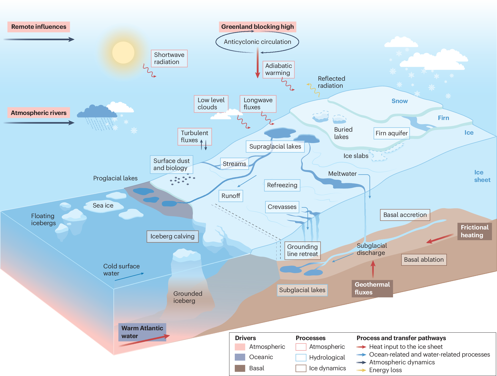
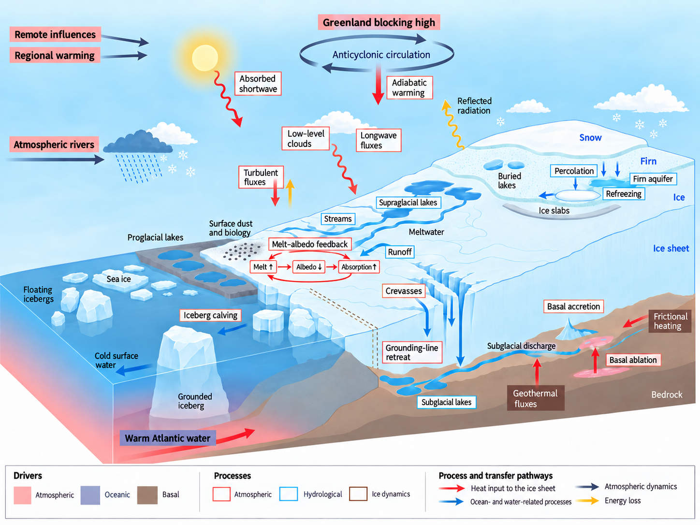
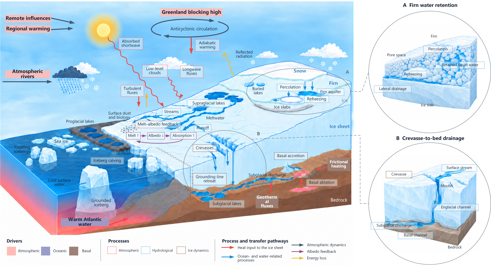

# Journal Macro Mechanism

A Codex skill for 2.5D scientific macro-scene mechanism figures, with optional local detail views and editable Visio annotations. The entry point is [SKILL.md](SKILL.md).

## Basic requirements

- A Codex environment that supports local skills, image inputs, and the built-in image generation/editing tool.
- For editable delivery: Microsoft Visio on Windows and a working computer-use integration or suitable Visio connector. Raster-only figure generation does not require Visio.
- Scientific source material: a written mechanism specification, abstract, paper, or existing figure, with the intended scope and label language.
- A confirmed visual style from the [style catalog](references/style-catalog.md), or an explicit custom treatment. Existing choices can be reused within their agreed scope.
- User review of the text-and-layout skeleton and then the complete annotated figure. Optional local subjects are selected after main-figure approval.

Place this repository's contents in `~/.codex/skills/journal-macro-mechanism/`, retaining `SKILL.md`, `agents/`, and `references/`, and invoke `$journal-macro-mechanism`.

No OCR service, PaddleOCR token, separate image-generation API key, or Illustrator tracing is required. The editable workflow retains scene images as rasters and recreates text, boxes, leaders, arrows, locator marks, and legends as native Visio objects. Local views enlarge macro-object structures and physical processes; microscopic biochemistry and internal electronic-device mechanisms remain outside scope.

## Test cases

The following are qualitative workflow tests completed during development. The first three images were supplied for this release; the fourth was exported directly from the assembled Visio document. They are not quantitative model benchmarks. Fine adjustments to text and box formatting are left to the user after assembly.

### 1. Wildfire: generation from a written specification

Generated a complete annotated climate–wildfire mechanism scene from a written specification informed by the article below, covering drivers, process relationships, feedbacks, and a semantic legend. This test demonstrates scene generation from a scientific specification rather than reconstruction of an existing image layout. This historical test image is shown as supplied; the current skill defaults to no overall title inside the artwork.

Scientific source: Whaley et al., *Current model capabilities and future predictive pathways of wildfires under a changing climate*, Communications Earth & Environment 7, 749 (2026), [article and DOI: 10.1038/s43247-026-04013-w](https://www.nature.com/articles/s43247-026-04013-w).

### 2. Greenland: article-based redraw

Redrew a Greenland Ice Sheet mechanism figure using the article abstract, the supplied original figure, and reviewed corrections. The test addressed nearby object labels, separate driver/process/pathway legend roles, directed circulation, material-state distinctions, and removal of long discussion panels.

Article: Hanna et al., *Past, present and future Greenland Ice Sheet surface melt, 1500–2200 CE*, Nature Reviews Earth & Environment (2026), [DOI: 10.1038/s43017-026-00800-3](https://doi.org/10.1038/s43017-026-00800-3). The supplied original below is the article reference, not a generated result; attribution remains with its authors and publisher. See the [original Figure 1](https://www.nature.com/articles/s43017-026-00800-3/figures/1).

**Supplied article figure**

**Redrawn mechanism figure**

### 3. Greenland: approved local detail views and Visio assembly

After approval of the annotated overview, two local subjects were selected: firn percolation, retained water and refreezing; and a connected crevasse/moulin-to-subglacial drainage pathway. The clean main scene and both annotation-free local images were generated separately, then assembled in Visio with native text, frames, arrows, locator circles, correspondence lines, and a legend.

The assembled document was opened and saved in Visio. The following complete illustration was exported from Visio as a 300 × 300 DPI PNG. It demonstrates the local-view layout and final assembly; the PNG itself is flattened, while editability belongs to the native Visio document.

